# 中医声诊样本风险三分类实验报告

> 生成日期：2026-10-13。本报告全部指标来自真实运行（嵌套交叉验证外层折外预测）。

## 1 摘要

在当前 27 条样本、外层 5 折内层 3 折嵌套 CV 方案下，按**预先固定**的 macro-F1 规则，胜者为 **Random Forest (随机森林)**（OOF macro-F1=0.5386、Accuracy=0.5556）。

但必须同时说明三点：

1. **它只在部分指标上胜出。** macro ROC-AUC 与 mAP 最好的调参模型分别是 XGBoost（AUC=0.6584）与 XGBoost（mAP=0.5425），不能说随机森林在所有指标上都最优。
2. **胜者的分数含事后挑选的乐观性。** 它是在同一批折外预测上挑出的最高分；各模型的嵌套评估不能自动成为「获胜模型选择过程」的无偏估计。（报告 §4.11 另给出一个不含事后挑选的内层选择策略结果作为对照，但那是**另一套策略**的表现，两者之差不可解释为偏差大小。）
3. **逐类看，最要紧的问题是高危类几乎识别不出**（召回率见 §4.8）。整体 Accuracy 主要由低危与中危两类支撑。

调参对个别模型有提升（如随机森林、XGBoost），对部分模型反而下降，反映出小样本下内层选择噪声大。受样本量限制，所有模型 OOF 指标波动较大，不能据此声称临床部署有效或外部人群泛化良好。

**扩展分析（第 5–7 章）补充的要点：**

- **高危类几乎没有可用的区分能力**：6 个调参模型中有 6 个的高危类 OvR AUC 低于 0.5（§5.3），与高危召回率低（§4.8）相互印证。
- **标签置换检验**（默认超参数，100 次置换，§6.3）：没有任何模型达到 p<0.05，无法排除「分数只是随机水平」。
- **结论对评估方案敏感**：换用不同 CV 方案或随机切分，同一模型的 macro-F1 与模型名次都会明显变化（§5.7、§6.1、§6.2）；留一法在本数据上对先验基线有系统性悲观偏差。
- **SHAP**：最终模型前三重要特征为 F1、I、F4；在至少 4 个模型中都排进前三的是 F1、I（§7.5），全量与折外 SHAP 排名的 Spearman ρ=0.98（§7.4）。这只说明模型「用了」哪些特征；在整体性能接近基线时，不能当作诊断指标有效的证据。

## 2 数据与实验设置

- 输入附件：`inputs/声诊练习.xlsx`（27 条有效样本 × 10 个数值特征）、`inputs/中医声诊实验.docx`（实验背景参考）。
- 特征列（表头原样保留，`FO` 为字母 O，未改作 `F0`）：FO, I, F1, F2, F3, F4, B1, B2, B3, B4。
- 类别映射（固定）：低危=0，中危=1，高危=2；三类各 9 条。
- 切分：外层 5 折、内层 3 折分层嵌套交叉验证，`StratifiedKFold(shuffle=True, random_state=42)`；所有模型共享同一组外层索引。
- 调参：内层主评分固定 macro-F1；LR/SVM/GNB/KNN 用 GridSearchCV，RF/XGBoost 用 RandomizedSearchCV（每折 ≤ 20 候选）；所有拟合型预处理均位于 Pipeline 内、只在训练折内拟合。
- 指标：Accuracy、macro/weighted/逐类 Precision、Recall、F1、OvR ROC-AUC（逐类+macro）、mAP（逐类 AP 算术平均）、macro PR-AUC（PR 曲线梯形积分，与 AP 算法不同）。
- 补充：种子 43、44 各完整重复嵌套流程，考察切分稳定性；主结果仍用 42。
- 扩展分析（第 5–7 章）：补充对比曲线、交叉验证方案对比与置换检验、学习/验证曲线、概率校准、SHAP 蜂群/依赖/瀑布图、折外 SHAP 与六模型 SHAP 对比。它们**不改动**上述主实验规则与胜者判定。

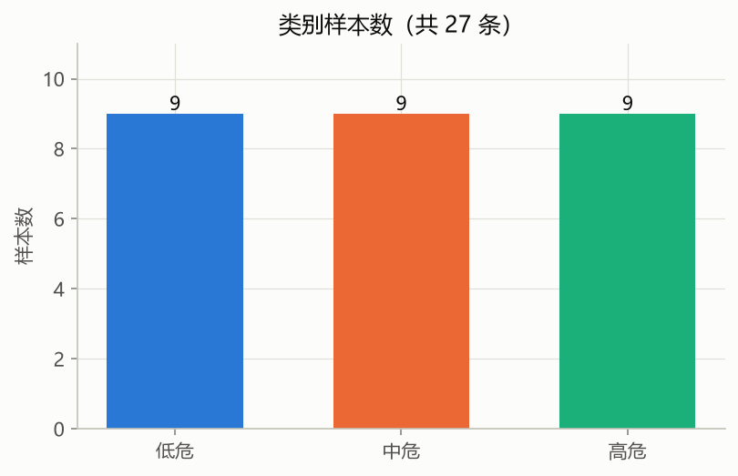

原始附件 SHA-256（确认未修改）：
- `inputs/声诊练习.xlsx`：`34355839cf5ca5945600f348dafc4ba2e4608f5a989815335c4b32ec2b7cbf26`
- `inputs/中医声诊实验.docx`：`44080bc706df51d66e1211bc5d85a48970ab777e9169bcd58dd6d758472518f3`

## 3 环境核验

- 操作系统 / 架构：Windows-11-10.0.26200-SP0 / AMD64
- 解释器：3.14.7，路径 `C:\Users\swild\Documents\ChatGPT\coding\ml-project\.venv\Scripts\python.exe`
- `python -m pip check`：No broken requirements found.
- 关键包版本：
- matplotlib==3.11.2
- numpy==2.5.3
- pandas==3.0.6
- scikit-learn==1.9.1
- scipy==1.18.1
- seaborn==0.13.2
- shap==0.52.0
- xgboost==3.4.1

## 4 结果

### 4.1 OOF 汇总指标（27 条折外预测，种子 42）

下表为从 OOF 预测重新计算的完整汇总值（区别于逐折均值的平均）。

| 模型 | 版本 | accuracy | precision_macro | recall_macro | f1_macro | roc_auc_macro | mAP | pr_auc_macro |
| --- | --- | --- | --- | --- | --- | --- | --- | --- |
| Logistic Regression (逻辑回归) | 未调参 | 0.370 | 0.386 | 0.370 | 0.377 | 0.512 | 0.429 | 0.391 |
| Logistic Regression (逻辑回归) | 调参 | 0.296 | 0.329 | 0.296 | 0.309 | 0.457 | 0.361 | 0.321 |
| SVM (支持向量机) | 未调参 | 0.481 | 0.463 | 0.481 | 0.466 | 0.626 | 0.475 | 0.434 |
| SVM (支持向量机) | 调参 | 0.407 | 0.344 | 0.407 | 0.365 | 0.537 | 0.468 | 0.443 |
| Gaussian Naive Bayes (高斯朴素贝叶斯) | 未调参 | 0.519 | 0.524 | 0.519 | 0.518 | 0.603 | 0.514 | 0.483 |
| Gaussian Naive Bayes (高斯朴素贝叶斯) | 调参 | 0.481 | 0.482 | 0.481 | 0.481 | 0.586 | 0.501 | 0.470 |
| KNN (K 近邻) | 未调参 | 0.444 | 0.310 | 0.444 | 0.364 | 0.621 | 0.437 | 0.383 |
| KNN (K 近邻) | 调参 | 0.370 | 0.277 | 0.370 | 0.316 | 0.551 | 0.423 | 0.407 |
| Random Forest (随机森林) | 未调参 | 0.481 | 0.402 | 0.481 | 0.433 | 0.626 | 0.540 | 0.506 |
| Random Forest (随机森林) | 调参 | 0.556 | 0.537 | 0.556 | 0.539 | 0.588 | 0.521 | 0.495 |
| XGBoost | 未调参 | 0.444 | 0.482 | 0.444 | 0.458 | 0.593 | 0.481 | 0.448 |
| XGBoost | 调参 | 0.481 | 0.491 | 0.481 | 0.479 | 0.658 | 0.543 | 0.507 |
| Dummy (先验基线) | 基线 | 0.259 | 0.231 | 0.259 | 0.223 | 0.420 | 0.301 | 0.316 |

*注：SVM 的 ROC/PR 使用 decision_function 决策分数（非概率、未做校准），不参与概率行和≈1 的检查；其余模型为 predict_proba 概率。*

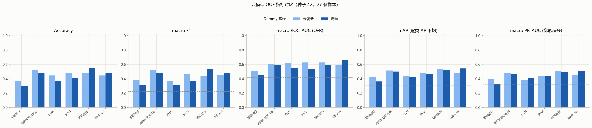

### 4.2 逐折指标（均值 ± 标准差，跨 5 个外层折）

标准差是跨折变动，不是置信区间。

| 模型 | 版本 | accuracy | precision_macro | recall_macro | f1_macro | roc_auc_macro | mAP | pr_auc_macro |
| --- | --- | --- | --- | --- | --- | --- | --- | --- |
| Dummy 基线 | 基线 | 0.253±0.065 | 0.084±0.022 | 0.333±0.000 | 0.133±0.027 | 0.500±0.000 | 0.333±0.000 | 0.667±0.000 |
| 高斯朴素贝叶斯 | 调参 | 0.480±0.129 | 0.478±0.188 | 0.500±0.149 | 0.453±0.118 | 0.622±0.116 | 0.601±0.105 | 0.491±0.148 |
| 高斯朴素贝叶斯 | 未调参 | 0.520±0.181 | 0.511±0.266 | 0.533±0.194 | 0.487±0.199 | 0.650±0.142 | 0.621±0.126 | 0.513±0.165 |
| KNN | 调参 | 0.373±0.131 | 0.283±0.067 | 0.367±0.163 | 0.304±0.094 | 0.558±0.140 | 0.492±0.136 | 0.519±0.094 |
| KNN | 未调参 | 0.447±0.202 | 0.283±0.156 | 0.400±0.170 | 0.324±0.161 | 0.632±0.119 | 0.522±0.100 | 0.540±0.163 |
| 逻辑回归 | 调参 | 0.293±0.183 | 0.311±0.213 | 0.300±0.194 | 0.287±0.183 | 0.464±0.122 | 0.521±0.120 | 0.416±0.159 |
| 逻辑回归 | 未调参 | 0.380±0.139 | 0.344±0.142 | 0.367±0.125 | 0.333±0.110 | 0.481±0.126 | 0.544±0.113 | 0.447±0.148 |
| 随机森林 | 调参 | 0.560±0.049 | 0.504±0.076 | 0.533±0.067 | 0.483±0.037 | 0.592±0.092 | 0.603±0.085 | 0.506±0.128 |
| 随机森林 | 未调参 | 0.480±0.147 | 0.438±0.075 | 0.467±0.163 | 0.416±0.101 | 0.611±0.166 | 0.626±0.135 | 0.548±0.177 |
| SVM | 调参 | 0.407±0.053 | 0.306±0.096 | 0.400±0.082 | 0.329±0.077 | 0.511±0.141 | 0.542±0.071 | 0.434±0.054 |
| SVM | 未调参 | 0.473±0.104 | 0.427±0.224 | 0.467±0.125 | 0.405±0.147 | 0.622±0.119 | 0.608±0.118 | 0.503±0.166 |
| XGBoost | 调参 | 0.473±0.164 | 0.467±0.143 | 0.433±0.170 | 0.427±0.145 | 0.642±0.148 | 0.643±0.115 | 0.560±0.128 |
| XGBoost | 未调参 | 0.440±0.116 | 0.439±0.143 | 0.433±0.133 | 0.416±0.132 | 0.567±0.190 | 0.576±0.129 | 0.469±0.148 |

### 4.3 调参搜索预算

| 模型 | 搜索类型 | 空间大小 | 每折候选 | 每折拟合数 | 调参总拟合数 |
| --- | --- | --- | --- | --- | --- |
| 逻辑回归 | grid | 5 | 5 | 15 | 75 |
| SVM | grid | 20 | 20 | 60 | 300 |
| 高斯朴素贝叶斯 | grid | 5 | 5 | 15 | 75 |
| KNN | grid | 16 | 16 | 48 | 240 |
| 随机森林 | random | 48 | 20 | 60 | 300 |
| XGBoost | random | 144 | 20 | 60 | 300 |

### 4.4 调参前后对比

- 逻辑回归：macro-F1 0.377 → 0.309（下降 -0.069）。
- SVM：macro-F1 0.466 → 0.365（下降 -0.101）。
- 高斯朴素贝叶斯：macro-F1 0.518 → 0.481（下降 -0.037）。
- KNN：macro-F1 0.364 → 0.316（下降 -0.048）。
- 随机森林：macro-F1 0.433 → 0.539（提升 +0.105）。
- XGBoost：macro-F1 0.458 → 0.479（提升 +0.021）。

各模型外层折最优超参数（取多数出现或逐折记录见 `results/seed42/folds.csv`）：

| 模型 | 最优参数（多数） | 出现折数 |
| --- | --- | --- |
| 逻辑回归 | {'C': 10.0} | 2/5 |
| SVM | {'C': 10.0, 'gamma': 'scale', 'kernel': 'rbf'} | 4/5 |
| 高斯朴素贝叶斯 | {'var_smoothing': 0.001} | 4/5 |
| KNN | {'n_neighbors': 3, 'p': 1, 'weights': 'uniform'} | 2/5 |
| 随机森林 | {'max_depth': 2, 'max_features': 1.0, 'min_samples_leaf': 1, 'n_estimators': 100} | 1/5 |
| XGBoost | {'colsample_bytree': 1.0, 'learning_rate': 0.03, 'max_depth': 1, 'n_estimators': 50, 'reg_lambda': 1.0, 'subsample': 1.0} | 2/5 |

### 4.5 训练分数与外层分数差距（过拟合观察）

| 模型 | 版本 | train_f1_macro | train_accuracy | oof_f1_macro | oof_accuracy |
| --- | --- | --- | --- | --- | --- |
| 逻辑回归 | 未调参 | 0.741 | 0.750 | 0.377 | 0.370 |
| 逻辑回归 | 调参 | 0.677 | 0.710 | 0.309 | 0.296 |
| SVM | 未调参 | 0.914 | 0.916 | 0.466 | 0.481 |
| SVM | 调参 | 0.919 | 0.933 | 0.365 | 0.407 |
| 高斯朴素贝叶斯 | 未调参 | 0.838 | 0.842 | 0.518 | 0.519 |
| 高斯朴素贝叶斯 | 调参 | 0.765 | 0.777 | 0.481 | 0.481 |
| KNN | 未调参 | 0.491 | 0.584 | 0.364 | 0.444 |
| KNN | 调参 | 0.755 | 0.794 | 0.316 | 0.370 |
| 随机森林 | 未调参 | 1.000 | 1.000 | 0.433 | 0.481 |
| 随机森林 | 调参 | 0.972 | 0.972 | 0.539 | 0.556 |
| XGBoost | 未调参 | 1.000 | 1.000 | 0.458 | 0.444 |
| XGBoost | 调参 | 0.924 | 0.927 | 0.479 | 0.481 |

### 4.6 六模型曲线对比（OOF 分数）

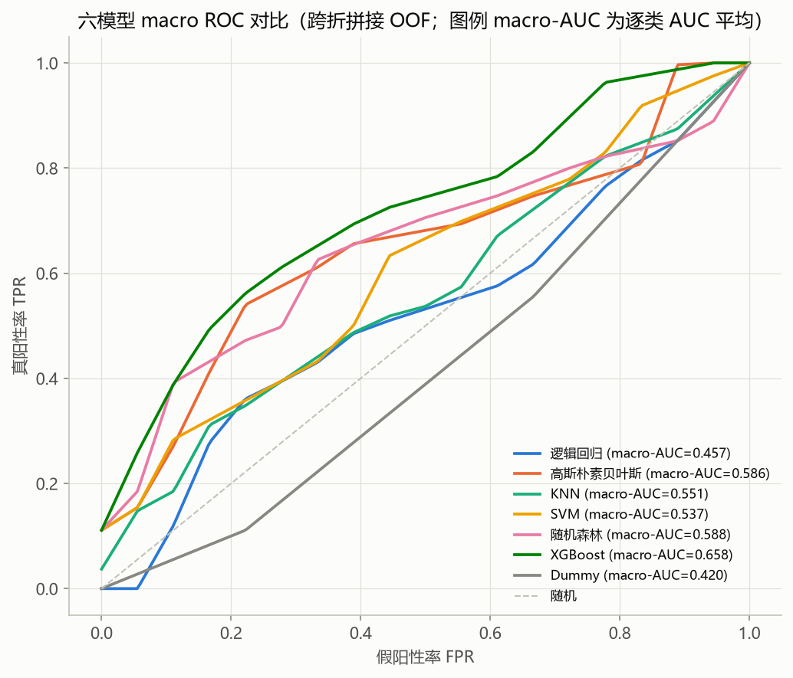

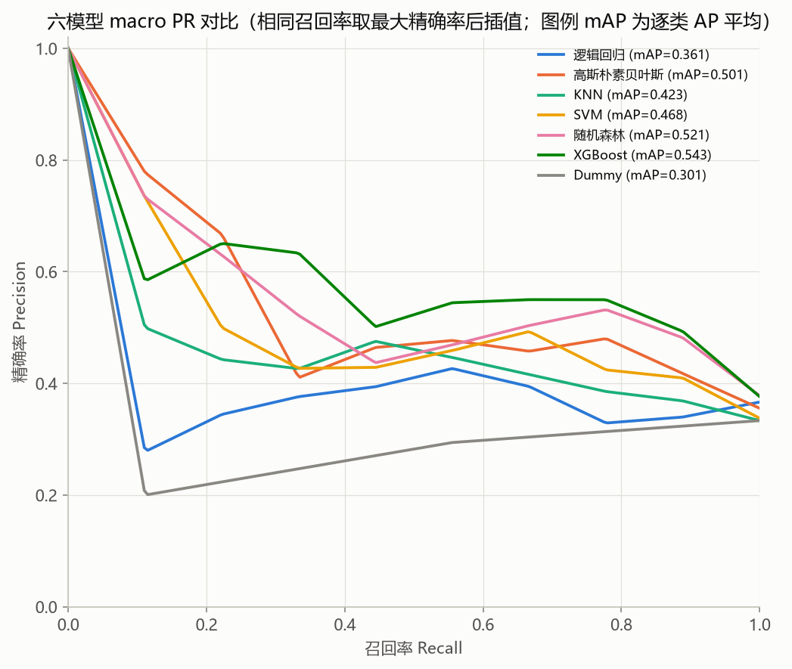

*读图口径（四点，容易误读）：*

1. 图例中的 macro-AUC 来自**逐类 ROC-AUC 算术平均**、mAP 来自**逐类 AP 算术平均**，两者都**不是**平均曲线本身的面积，不要互相替代。
2. macro PR 曲线按「**相同召回率取最大精确率**」去重后再线性插值到公共 recall 网格。该做法会消除垂直段、使曲线偏高，因此平均曲线下方的面积**大于** mAP 与梯形 PR-AUC（三者算法不同：mAP=逐类 AP 平均、pr_auc_macro=逐类梯形积分、此图=插值后平均曲线）。把这里的 max 直接改成 min 也不是通用正确修复；换展示口径需另行说明。
3. 曲线由**跨折拼接**的 OOF 分数绘制。Dummy 每折 AUC≈0.5，但拼接后约 0.42，这是不同训练折先验分数之间的排序效应，**不应**把该曲线当作理论随机基线，也不代表 AUC 实现有误。
4. SVM 的分数是 decision_function 决策分数，跨折可能存在尺度差异，故同时保留逐折指标。

### 4.7 逐类 ROC / PR 曲线

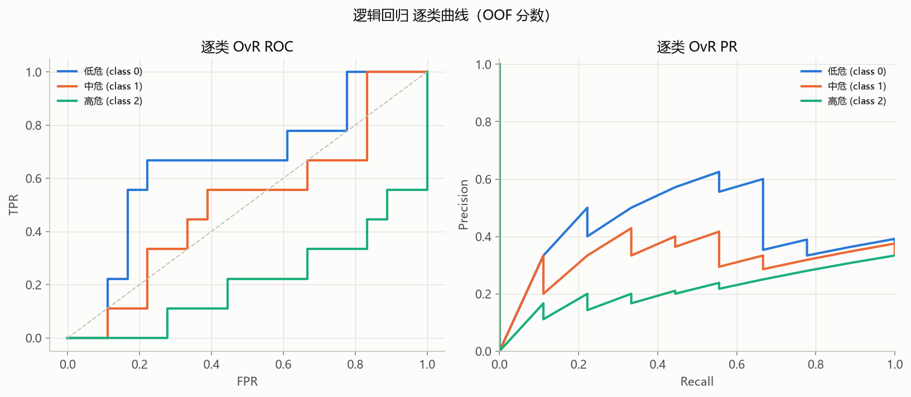

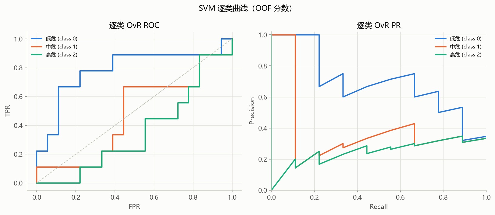

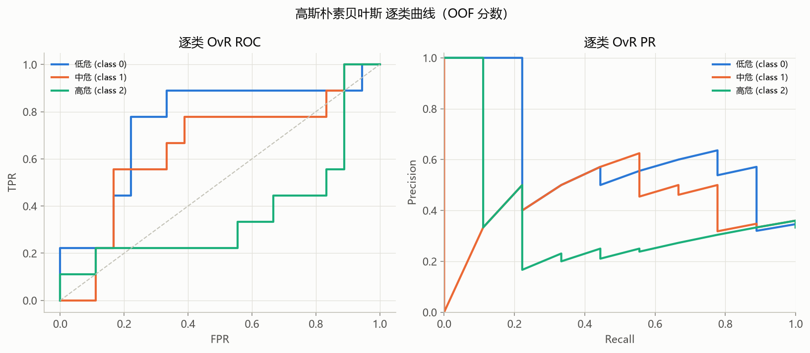

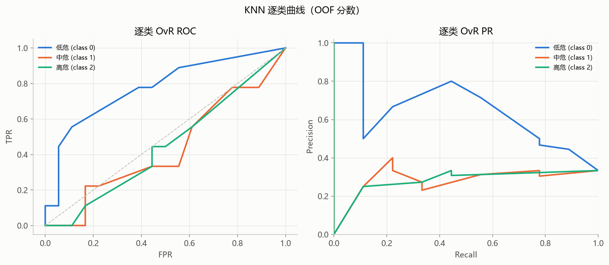

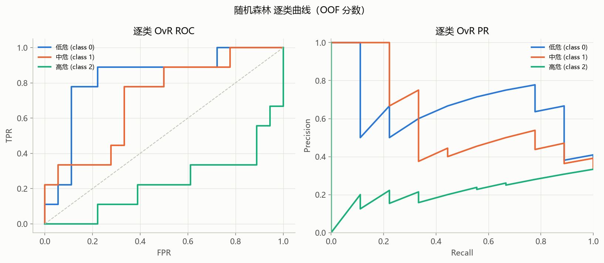

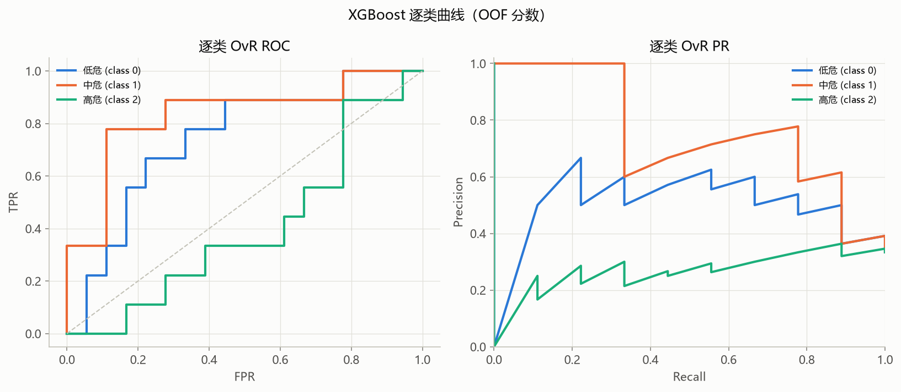

### 4.8 混淆矩阵

按预先确定的 macro-F1，胜者为 **Random Forest (随机森林)**（OOF macro-F1=0.539，Accuracy=0.556）。单独标记的 Accuracy 最高模型为 **Random Forest (随机森林)**（Accuracy=0.556）。

按真实类别拆开看，胜者的逐类召回率为：低危 **77.8%**（7/9）、中危 **66.7%**（6/9）、高危 **仅 22.2%**（2/9）。

也就是说，7 条真实高危样本没有被识别为高危。在三分类风险预警里，这比「哪个模型是冠军」重要得多：**模型对最需要预警的类别几乎失效**，高分主要来自低危与中危两类。任何关于本实验「可用性」的表述都必须先说明这一点。（这里评价的是给定标签下的实验表现，不推断真实疾病结局。）

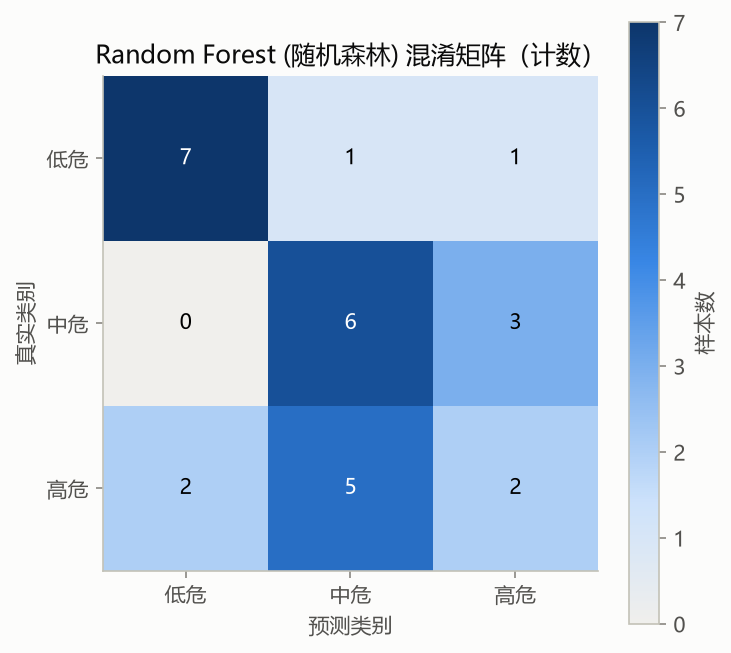

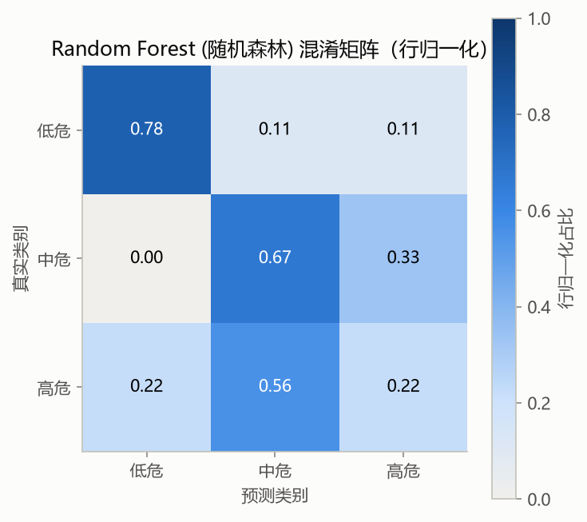

### 4.9 SHAP 特征重要性（训练后描述性分析）

- 解释对象：最终所选模型（Random Forest (随机森林)）。
- 解释器：TreeExplainer(tree_path_dependent)；背景：原始特征空间（树模型无缩放；imputer 恒等，已验证）；解释对象：全部 27 条训练样本；输出空间：predict_proba 概率。
- 说明：训练后描述性分析，非外部验证，非因果关系证据；解释空间见 background 字段。

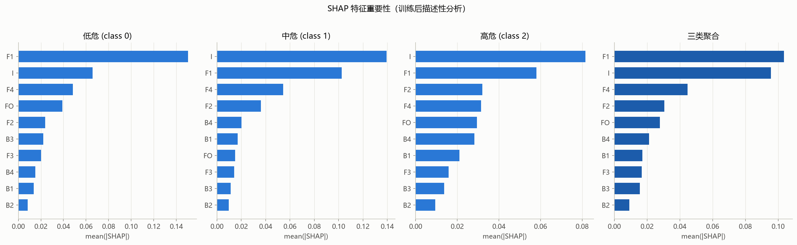

三类聚合 mean(|SHAP|) 排名：

| 特征 | mean(\|SHAP\|) | 排名 |
| --- | --- | --- |
| F1 | 0.1036 | 1 |
| I | 0.0956 | 2 |
| F4 | 0.0448 | 3 |
| F2 | 0.0306 | 4 |
| FO | 0.0278 | 5 |
| B4 | 0.0212 | 6 |
| B1 | 0.0172 | 7 |
| F3 | 0.0167 | 8 |
| B3 | 0.0157 | 9 |
| B2 | 0.0091 | 10 |

### 4.10 切分稳定性（种子 43、44 补充）

以下为各模型（调参版）在三个种子下的 OOF 指标，用于观察表现对切分的敏感性。重复切分不是新增独立样本，不能把 81 次预测当作 81 名患者来缩小置信区间。

| 种子 | 模型 | accuracy | f1_macro | roc_auc_macro | mAP | pr_auc_macro |
| --- | --- | --- | --- | --- | --- | --- |
| 42 | 逻辑回归 | 0.296 | 0.309 | 0.457 | 0.361 | 0.321 |
| 42 | SVM | 0.407 | 0.365 | 0.537 | 0.468 | 0.443 |
| 42 | 高斯朴素贝叶斯 | 0.481 | 0.481 | 0.586 | 0.501 | 0.470 |
| 42 | KNN | 0.370 | 0.316 | 0.551 | 0.423 | 0.407 |
| 42 | 随机森林 | 0.556 | 0.539 | 0.588 | 0.521 | 0.495 |
| 42 | XGBoost | 0.481 | 0.479 | 0.658 | 0.543 | 0.507 |
| 43 | 逻辑回归 | 0.222 | 0.228 | 0.412 | 0.326 | 0.290 |
| 43 | SVM | 0.333 | 0.308 | 0.484 | 0.373 | 0.329 |
| 43 | 高斯朴素贝叶斯 | 0.296 | 0.312 | 0.484 | 0.417 | 0.380 |
| 43 | KNN | 0.481 | 0.412 | 0.605 | 0.435 | 0.453 |
| 43 | 随机森林 | 0.370 | 0.368 | 0.549 | 0.466 | 0.429 |
| 43 | XGBoost | 0.407 | 0.400 | 0.586 | 0.471 | 0.442 |
| 44 | 逻辑回归 | 0.370 | 0.371 | 0.521 | 0.417 | 0.375 |
| 44 | SVM | 0.556 | 0.547 | 0.695 | 0.610 | 0.586 |
| 44 | 高斯朴素贝叶斯 | 0.444 | 0.420 | 0.556 | 0.484 | 0.456 |
| 44 | KNN | 0.444 | 0.431 | 0.582 | 0.420 | 0.419 |
| 44 | 随机森林 | 0.444 | 0.429 | 0.586 | 0.530 | 0.496 |
| 44 | XGBoost | 0.556 | 0.547 | 0.630 | 0.537 | 0.508 |

### 4.11 不确定性量化与选择乐观性（补充分析）

本节为**补充分析**，不改动 §2 预先固定的主实验规则（随机种子、外层/内层切分、内层评分、胜者判定规则全部不变），只对已经算出的折外预测做进一步的统计刻画。

下表是对 27 条折外预测做**样本级 bootstrap 重采样（2000 次）**得到的百分位区间。它刻画的是「这 27 条样本」内部的抽样波动，**不是**人群抽样分布，也不能把种子 42/43/44 的 81 次重复预测当成 81 名患者。

**有效抽样规则**：一次抽样只有**三类都出现**时才计入；缺任一类则该次对**全部指标**作废（计入「缺类作废数」）。不按剩余类别凑一个 macro 值、也不用 0 顶替——否则 macro 平均的类别数会在各次之间变化。本轮实际未出现缺类抽样（各模型「缺类作废数」均为 0），但规则与代码、测试一致。

**适用范围（重要）**：本区间固定了已经拟合好的折外预测，只重采样行；它**没有**重新执行训练、调参、切分与胜者选择，也未建模交叉验证各折训练集之间的重叠。因此它**不是**「完整建模流程泛化性能」的已证 95% 置信区间。

| 模型 | 指标 | OOF 点估计 | bootstrap 95% 区间 | 重采样次数 | 有效重采样数 | 缺类作废数 |
| --- | --- | --- | --- | --- | --- | --- |
| 逻辑回归 | accuracy | 0.296 | [0.148, 0.481] | 2000 | 2000 | 0 |
| 逻辑回归 | f1_macro | 0.309 | [0.131, 0.470] | 2000 | 2000 | 0 |
| 逻辑回归 | roc_auc_macro | 0.457 | [0.329, 0.604] | 2000 | 2000 | 0 |
| 逻辑回归 | mAP | 0.361 | [0.310, 0.529] | 2000 | 2000 | 0 |
| SVM | accuracy | 0.407 | [0.222, 0.593] | 2000 | 2000 | 0 |
| SVM | f1_macro | 0.365 | [0.226, 0.508] | 2000 | 2000 | 0 |
| SVM | roc_auc_macro | 0.537 | [0.375, 0.690] | 2000 | 2000 | 0 |
| SVM | mAP | 0.468 | [0.367, 0.615] | 2000 | 2000 | 0 |
| 高斯朴素贝叶斯 | accuracy | 0.481 | [0.296, 0.667] | 2000 | 2000 | 0 |
| 高斯朴素贝叶斯 | f1_macro | 0.481 | [0.301, 0.646] | 2000 | 2000 | 0 |
| 高斯朴素贝叶斯 | roc_auc_macro | 0.586 | [0.424, 0.755] | 2000 | 2000 | 0 |
| 高斯朴素贝叶斯 | mAP | 0.501 | [0.389, 0.700] | 2000 | 2000 | 0 |
| KNN | accuracy | 0.370 | [0.185, 0.556] | 2000 | 2000 | 0 |
| KNN | f1_macro | 0.316 | [0.177, 0.439] | 2000 | 2000 | 0 |
| KNN | roc_auc_macro | 0.551 | [0.409, 0.710] | 2000 | 2000 | 0 |
| KNN | mAP | 0.423 | [0.345, 0.587] | 2000 | 2000 | 0 |
| 随机森林 | accuracy | 0.556 | [0.370, 0.741] | 2000 | 2000 | 0 |
| 随机森林 | f1_macro | 0.539 | [0.362, 0.701] | 2000 | 2000 | 0 |
| 随机森林 | roc_auc_macro | 0.588 | [0.440, 0.727] | 2000 | 2000 | 0 |
| 随机森林 | mAP | 0.521 | [0.409, 0.680] | 2000 | 2000 | 0 |
| XGBoost | accuracy | 0.481 | [0.296, 0.667] | 2000 | 2000 | 0 |
| XGBoost | f1_macro | 0.479 | [0.295, 0.646] | 2000 | 2000 | 0 |
| XGBoost | roc_auc_macro | 0.658 | [0.504, 0.811] | 2000 | 2000 | 0 |
| XGBoost | mAP | 0.543 | [0.444, 0.730] | 2000 | 2000 | 0 |
| Dummy 基线 | accuracy | 0.259 | [0.111, 0.407] | 2000 | 2000 | 0 |
| Dummy 基线 | f1_macro | 0.223 | [0.083, 0.363] | 2000 | 2000 | 0 |
| Dummy 基线 | roc_auc_macro | 0.420 | [0.313, 0.553] | 2000 | 2000 | 0 |
| Dummy 基线 | mAP | 0.301 | [0.294, 0.387] | 2000 | 2000 | 0 |

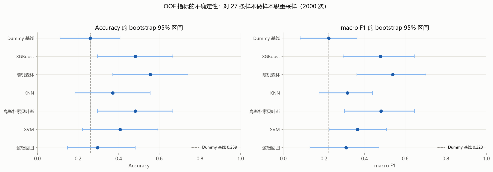

**胜者与先验基线的配对检验**

胜者 **随机森林** 与 Dummy 先验基线使用同一组 27 条折外预测，可作配对比较：两者都判对 3 条、都判错 8 条，胜者判对而基线判错 12 条、反之 4 条。精确 McNemar 双尾 p = **0.0768**，在 0.05 水平下**不显著**：以本样本量尚不能认为胜者优于先验基线。 不一致对仅 16 条，检验功效很低；p 不显著只表示「未观察到显著差异」，不等于「两者相同」。

**局限**：应把本检验视为**探索性比较**。「精确」仅指二项尾概率的算法精确——胜者本身来自同一批折外预测的筛选、各折模型又共享训练数据，因此它不构成对整个「选模流程」的精确检验；且它只比较**错误率**，不涉及 macro-F1、ROC-AUC 或排序质量。不宜把该 p 值当作强证据。

**含模型选择的无事后挑选估计**

这里换一种**不含事后挑选**的做法：每个外层折只按**该折的内层 macro-F1** 决定用哪个模型（折 0→XGBoost、折 1→KNN、折 2→KNN、折 3→XGBoost、折 4→XGBoost），再拼接各折折外预测。结果为 Accuracy=0.481、macro-F1=0.462；作为对照，事后在同一批折外预测上挑出的 **随机森林** 为 Accuracy=0.556、macro-F1=0.539。

**这两个数值不能相减来解释为偏差的大小。** 它们来自**两套不同的选模策略**：前者外层实际用的是 KNN/XGBoost，后者用的是 随机森林。两者之差同时混合了(a)策略不同、(b)有限样本波动、(c)事后挑选的乐观性三种来源，无法单独识别 (c)，更不能当作随机森林经偏差校正后的成绩。

由此能得到的结论只有一条：**本次结果对「用哪种方式选模型」是敏感的**——内层选择策略在外层评估中表现更差，且各折选出的模型并不固定在随机森林上，说明当前样本量下模型排名本身不稳定。该估计衡量的是「模型选择这个过程」的表现，仍不是独立外部测试集。

## 5 补充对比曲线

本章的曲线全部来自第 4 章同一批真实折外预测（种子 42）或逐折记录，只换展示角度，不引入新的训练结果。

### 5.1 调参前后 ROC 对比

同一组外层切分下，调参使 macro ROC-AUC 上升的模型：XGBoost；下降的模型：逻辑回归、高斯朴素贝叶斯、KNN、SVM、随机森林。内层调参目标是 macro-F1，它并不保证排序质量（AUC）同步改善；小样本下两者方向不一致很常见。

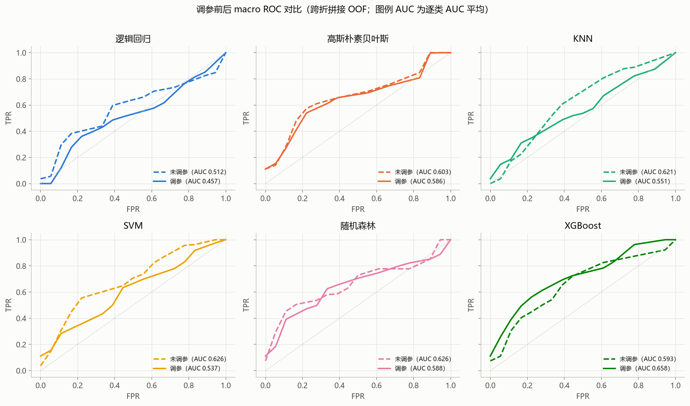

| 模型 | 未调参 AUC | 调参 AUC | ΔAUC | 未调参 F1 | 调参 F1 | ΔF1 |
| --- | --- | --- | --- | --- | --- | --- |
| 逻辑回归 | 0.512 | 0.457 | -0.056 | 0.377 | 0.309 | -0.069 |
| 高斯朴素贝叶斯 | 0.603 | 0.586 | -0.016 | 0.518 | 0.481 | -0.037 |
| KNN | 0.621 | 0.551 | -0.070 | 0.364 | 0.316 | -0.048 |
| SVM | 0.626 | 0.537 | -0.088 | 0.466 | 0.365 | -0.101 |
| 随机森林 | 0.626 | 0.588 | -0.037 | 0.433 | 0.539 | 0.105 |
| XGBoost | 0.593 | 0.658 | 0.066 | 0.458 | 0.479 | 0.021 |

### 5.2 逐折 ROC 与折间变动

每个外层折只有 5–6 条测试样本，单折 ROC 呈明显阶梯状。折间差异最大的是 **KNN**（单折 AUC 从 0.39 到 0.81）。阴影带是 ±1 标准差，反映「换一个测试折」带来的波动，不是置信区间。

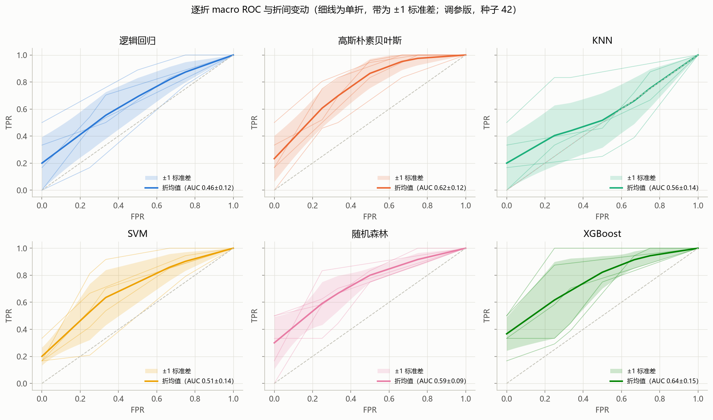

| 模型 | 逐折 AUC 均值 | 逐折 AUC 标准差 | 最低折 | 最高折 |
| --- | --- | --- | --- | --- |
| 逻辑回归 | 0.464 | 0.122 | 0.292 | 0.667 |
| 高斯朴素贝叶斯 | 0.622 | 0.116 | 0.417 | 0.750 |
| KNN | 0.558 | 0.140 | 0.389 | 0.806 |
| SVM | 0.511 | 0.141 | 0.292 | 0.694 |
| 随机森林 | 0.592 | 0.092 | 0.472 | 0.708 |
| XGBoost | 0.642 | 0.148 | 0.472 | 0.875 |

### 5.3 按风险类别比较各模型

把三分类拆成三个「一类 vs 其余」问题后，各模型在不同类别上的强弱并不一致。对最需要预警的 **高危** 类，AUC 最高的是 KNN（0.448），**6 个模型中有 6 个的高危类 AUC 低于 0.5**，即对高危样本的排序还不如随机——这与第 4.8 节「高危召回率很低」相互印证，是本实验最需要正视的结果。PR 图中的虚线是类别先验 1/3：AP 低于它说明该类排序不如随机。

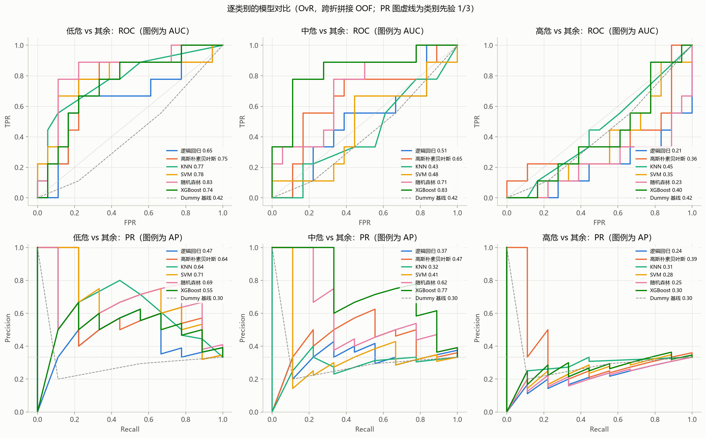

| 模型 | 低危 AUC | 中危 AUC | 高危 AUC | 低危 AP | 中危 AP | 高危 AP |
| --- | --- | --- | --- | --- | --- | --- |
| 逻辑回归 | 0.654 | 0.506 | 0.210 | 0.475 | 0.365 | 0.243 |
| 高斯朴素贝叶斯 | 0.747 | 0.648 | 0.364 | 0.642 | 0.471 | 0.389 |
| KNN | 0.775 | 0.432 | 0.448 | 0.640 | 0.320 | 0.308 |
| SVM | 0.784 | 0.475 | 0.352 | 0.711 | 0.411 | 0.283 |
| 随机森林 | 0.827 | 0.710 | 0.228 | 0.695 | 0.617 | 0.251 |
| XGBoost | 0.741 | 0.833 | 0.401 | 0.555 | 0.768 | 0.304 |
| Dummy 基线 | 0.420 | 0.420 | 0.420 | 0.301 | 0.301 | 0.301 |

### 5.4 外层逐折指标分布

箱线图展示 5 个外层折上的单折指标，与第 4.2 节的均值±标准差表对应。每折只有 5–6 条样本，单折 Accuracy 只能取 0、1/5、1/6……等少数离散值，因此箱体宽、点常重合。

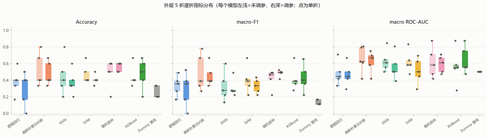

### 5.5 多指标雷达图

雷达图把 7 个汇总指标放在一起，便于看出模型是「全面均衡」还是「单项突出」。各轴数值与第 4.1 节表格相同；轴之间的面积没有统计含义，不要据此排名。

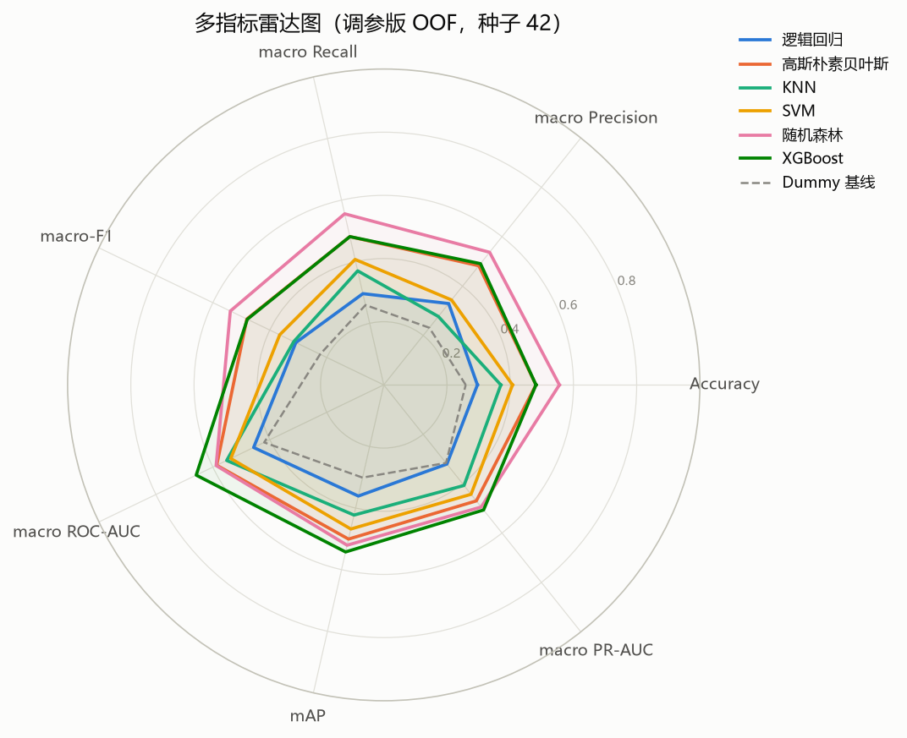

### 5.6 训练分数与折外分数差距

实心点为各外层训练折上的 macro-F1（逐折均值），空心点为外层测试折结果。调参版差距最大的是 **SVM**（0.92 → 0.37，差 +0.55）。差距大说明模型记住了训练样本，在 27 条样本上这比任何单项指标都更能说明「不能拿训练精度当泛化性能」。

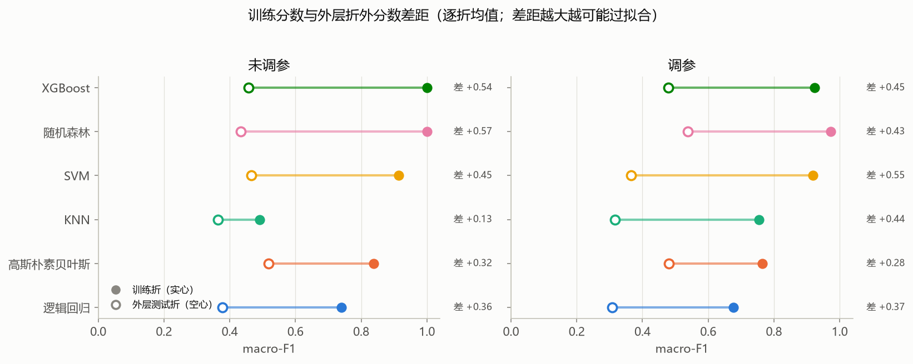

### 5.7 切分种子稳定性

三个种子下 macro-F1 第一名分别是：种子 42 → 随机森林、种子 43 → KNN、种子 44 → SVM。名次列按种子 42 / 43 / 44 顺序列出。三个种子的冠军**不一致**，说明模型排名对切分敏感。

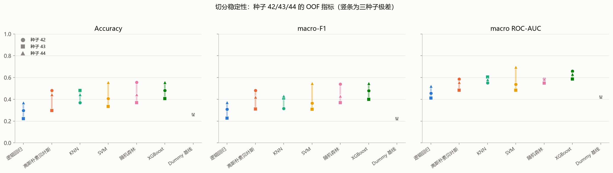

| 模型 | F1 最低 | F1 最高 | F1 极差 | 各种子 F1 名次 |
| --- | --- | --- | --- | --- |
| 逻辑回归 | 0.228 | 0.371 | 0.143 | 6 / 6 / 6 |
| 高斯朴素贝叶斯 | 0.312 | 0.481 | 0.169 | 2 / 4 / 5 |
| KNN | 0.316 | 0.431 | 0.115 | 5 / 1 / 3 |
| SVM | 0.308 | 0.547 | 0.239 | 4 / 5 / 1 |
| 随机森林 | 0.368 | 0.539 | 0.170 | 1 / 3 / 4 |
| XGBoost | 0.400 | 0.547 | 0.147 | 3 / 2 / 2 |

## 6 交叉验证深入分析

第 4 章的主结果来自预先固定的种子 42 嵌套交叉验证。本章换几个角度检查它：换一种 CV 方案结论是否一样、模型是否显著优于随机标签、样本量与超参数如何影响性能、输出概率是否可信。除 6.6 节使用主实验的调参版折外概率外，其余各节都使用**默认超参数**的完整 Pipeline，不在全数据上先调参，因此没有调参泄漏；但它们刻画的是模型家族的行为，**不替代**第 4 章的主结果，也不参与胜者判定。产物位于 `results/cv_analysis/`。

### 6.1 不同交叉验证方案的结果对比

下表为各模型（**默认超参数**，不调参）在 5 种 CV 方案下的折外 macro-F1。k 折与留一法为一次完整拼接；重复分层 5 折 ×10 为 10 次不同切分的均值。按 macro-F1 第一名：分层 3 折→高斯朴素贝叶斯、分层 5 折→高斯朴素贝叶斯、分层 9 折→随机森林、留一法 LOOCV→随机森林、重复分层 5 折 ×10→高斯朴素贝叶斯。

| 模型 | 分层 3 折 | 分层 5 折 | 分层 9 折 | 留一法 LOOCV | 重复分层 5 折 ×10 | 方案间极差 |
| --- | --- | --- | --- | --- | --- | --- |
| 逻辑回归 | 0.357 | 0.377 | 0.402 | 0.222 | 0.324 | 0.180 |
| 高斯朴素贝叶斯 | 0.492 | 0.518 | 0.444 | 0.412 | 0.422 | 0.105 |
| KNN | 0.312 | 0.364 | 0.333 | 0.333 | 0.349 | 0.053 |
| SVM | 0.360 | 0.466 | 0.382 | 0.299 | 0.413 | 0.167 |
| 随机森林 | 0.457 | 0.433 | 0.514 | 0.481 | 0.419 | 0.094 |
| XGBoost | 0.369 | 0.458 | 0.481 | 0.363 | 0.396 | 0.119 |
| Dummy 基线 | 0.167 | 0.223 | 0.167 | 0.000 | 0.223 | 0.223 |

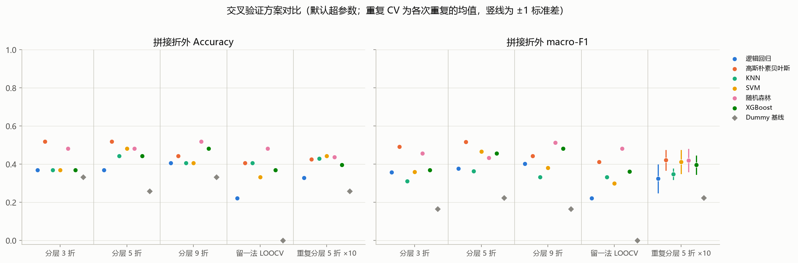

**留一法的已知陷阱**：Dummy 基线在留一法下 Accuracy = 0.000。原因是三类严格均衡时，每次留出一条样本，它所属的类在训练集中就成了少数类，先验基线永远预测另外两类之一——这是留一法在小样本、均衡类别上的系统性悲观偏差，不是代码错误。因此本项目主实验采用分层 k 折而非留一法；方案间极差列说明，**仅改变 CV 方案**就能让同一模型的 macro-F1 变动这么多。

### 6.2 重复交叉验证：仅换切分带来的波动

同一模型、同一数据，只换随机切分（10 次）时，拼接 macro-F1 的分布如下。它比单次 5 折更稳健地估计「默认参数下」的平均表现，但重复之间共享样本，不是独立重复实验。

| 模型 | 均值 | 标准差 | 最低 | 最高 |
| --- | --- | --- | --- | --- |
| 逻辑回归 | 0.324 | 0.073 | 0.194 | 0.439 |
| 高斯朴素贝叶斯 | 0.422 | 0.052 | 0.316 | 0.518 |
| KNN | 0.349 | 0.027 | 0.300 | 0.390 |
| SVM | 0.413 | 0.060 | 0.328 | 0.495 |
| 随机森林 | 0.419 | 0.058 | 0.335 | 0.512 |
| XGBoost | 0.396 | 0.047 | 0.318 | 0.458 |
| Dummy 基线 | 0.223 | 0.000 | 0.223 | 0.223 |

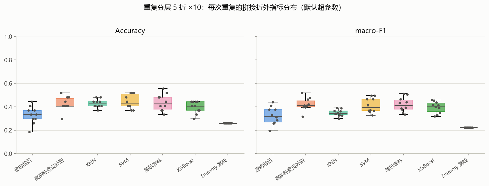

### 6.3 标签置换检验

把标签随机打乱 100 次，每次用同样的分层 5 折重新评估（默认超参数）。若真实标签的分数并不比打乱后的分数高，就说明模型学到的可能只是噪声。p 值 = (置换分数 ≥ 真实分数的次数 + 1) / (100 + 1)，最小可达 0.0099。

| 模型 | 真实标签 F1 | 置换均值 | 置换 95% 分位 | p 值 | 置换次数 |
| --- | --- | --- | --- | --- | --- |
| 逻辑回归 | 0.333 | 0.279 | 0.430 | 0.307 | 100 |
| SVM | 0.405 | 0.257 | 0.445 | 0.168 | 100 |
| 高斯朴素贝叶斯 | 0.487 | 0.283 | 0.494 | 0.079 | 100 |
| KNN | 0.324 | 0.272 | 0.449 | 0.327 | 100 |
| 随机森林 | 0.416 | 0.285 | 0.436 | 0.109 | 100 |
| XGBoost | 0.416 | 0.289 | 0.437 | 0.119 | 100 |

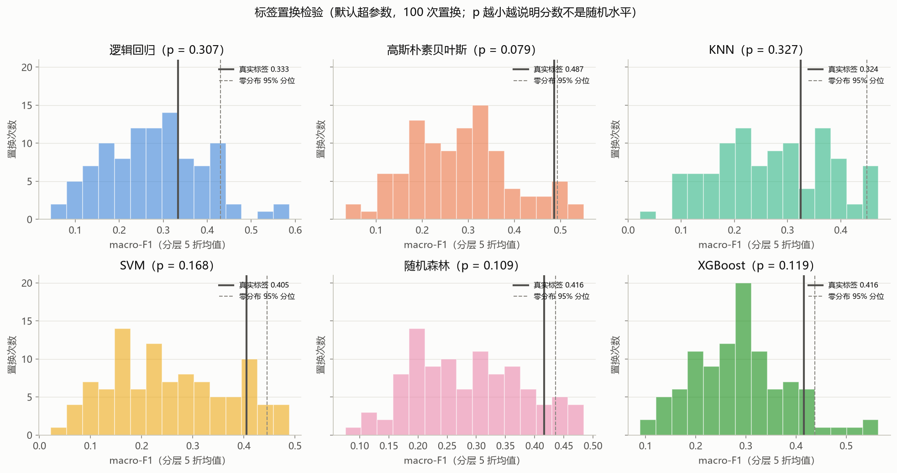

p < 0.05 的模型：**无**。即在默认参数下，没有一个模型能以 0.05 水平证明其分数优于「标签与特征无关」时的水平，这与第 4.11 节胜者对 Dummy 的配对检验不显著一致。置换检验只回答「是否优于随机」，不回答「哪个模型更好」。

### 6.4 学习曲线

在每个训练折内按「每类等量」子采样（6–21 条），观察测试折 macro-F1 随样本量的变化。从 n=6 到 n=21 测试 F1 提升超过 0.05 的模型：逻辑回归、高斯朴素贝叶斯、KNN、SVM、随机森林。若曲线在右端仍在上升、且训练-测试差距较大，说明**增加样本**比继续调参更可能带来改善。

| 模型 | 测试 F1 (n=6) | 测试 F1 (n=21) | 提升 | 训练-测试差 (n=21) |
| --- | --- | --- | --- | --- |
| 逻辑回归 | 0.219 | 0.286 | 0.067 | 0.471 |
| 高斯朴素贝叶斯 | 0.176 | 0.393 | 0.217 | 0.445 |
| KNN | 0.239 | 0.330 | 0.091 | 0.164 |
| SVM | 0.257 | 0.368 | 0.111 | 0.542 |
| 随机森林 | 0.300 | 0.403 | 0.103 | 0.597 |
| XGBoost | 0.377 | 0.413 | 0.035 | 0.587 |

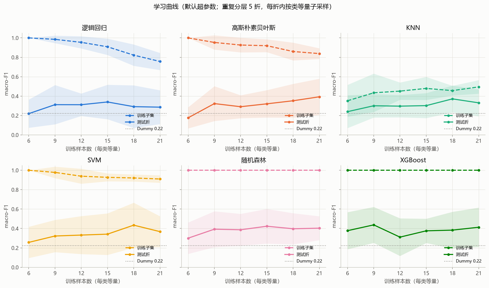

### 6.5 验证曲线（超参数敏感性）

每个模型只扫描一个关键超参数，其余保持默认。左侧通常欠拟合（训练、验证都低），右侧过拟合（训练高、验证低）。**注意**：全部 27 条样本都参与了这里的 CV，所以「验证最高取值」只是描述性的，不能拿来替换主实验的调参结果，也不能把它的分数当泛化性能。

| 模型 | 参数 | 验证最高取值 | 验证 F1 | 训练 F1 | 训练-验证差 | 验证 F1 范围 |
| --- | --- | --- | --- | --- | --- | --- |
| 逻辑回归 | C | 0.1 | 0.307 | 0.661 | 0.354 | 0.21–0.31 |
| 高斯朴素贝叶斯 | var_smoothing | 1e-11 | 0.414 | 0.828 | 0.414 | 0.38–0.41 |
| KNN | n_neighbors | 7 | 0.355 | 0.442 | 0.087 | 0.29–0.35 |
| SVM | C | 10.0 | 0.399 | 1.000 | 0.601 | 0.22–0.40 |
| 随机森林 | max_depth | 2 | 0.368 | 0.957 | 0.589 | 0.31–0.37 |
| XGBoost | max_depth | 1 | 0.407 | 1.000 | 0.593 | 0.36–0.41 |

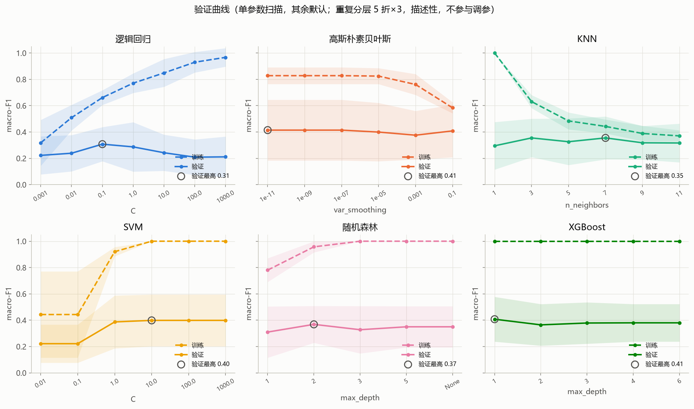

### 6.6 概率校准

对输出概率的模型（调参版 OOF 概率；SVM 输出决策分数，不在其中），检查「预测 70% 的样本是否真有约 70% 属于该类」。Brier 分数（三类多分类形式，0 最好）同时衡量校准与区分度；ECE 为 top-1 置信度与准确率之差的加权平均。

| 模型 | Brier | Log loss | ECE (top-1) | 平均置信度 | Accuracy |
| --- | --- | --- | --- | --- | --- |
| 逻辑回归 | 0.981 | 2.621 | 0.316 | 0.612 | 0.296 |
| 高斯朴素贝叶斯 | 0.912 | 4.822 | 0.408 | 0.890 | 0.481 |
| KNN | 0.889 | 9.581 | 0.288 | 0.658 | 0.370 |
| 随机森林 | 0.648 | 1.072 | 0.050 | 0.505 | 0.556 |
| XGBoost | 0.632 | 1.061 | 0.079 | 0.561 | 0.481 |
| Dummy 基线 | 0.674 | 1.110 | 0.091 | 0.350 | 0.259 |

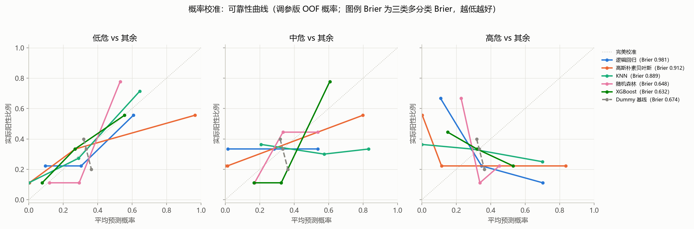

Dummy 基线的 Brier = 0.674；Brier 低于基线的模型：随机森林、XGBoost。每类只有 9 个正例、分箱只有 3 个，可靠性曲线非常粗糙，只能看方向（偏自信 / 偏保守），不足以支撑概率校准或阈值设定。

## 7 SHAP 可解释性深入分析

第 4.9 节给出了最终模型的 mean(|SHAP|) 排名。本章进一步回答：特征取值高低如何影响预测（蜂群图、依赖图）、单个样本的预测如何由各特征累加而成（瀑布图）、重要性排名换一批训练样本是否稳定（折外 SHAP）、换一个模型结论是否一致（六模型对比）。所有 SHAP 结果都是**模型行为的描述**，不是因果证据、不是外部验证；在模型整体表现接近基线（见 4.11、6.3 节）的前提下，更不能把重要特征解读为有效的诊断指标。产物位于 `results/shap/`。

### 7.1 SHAP 蜂群图：贡献方向与大小

每个点是一条样本，横轴为该特征对相应类别输出的 SHAP 贡献（predict_proba 概率），颜色为特征取值高低（蓝=低、红=高）。特征按三类聚合 mean(|SHAP|) 从上到下排序，前三位为 F1、I、F4。对「高危」输出，前三位特征取值与 SHAP 的 Spearman 相关为：F1（ρ=-0.57）、I（ρ=+0.76）、F4（ρ=+0.40）（正值表示取值越高越推向高危）。这是模型行为的描述，不是生理机制或因果关系。

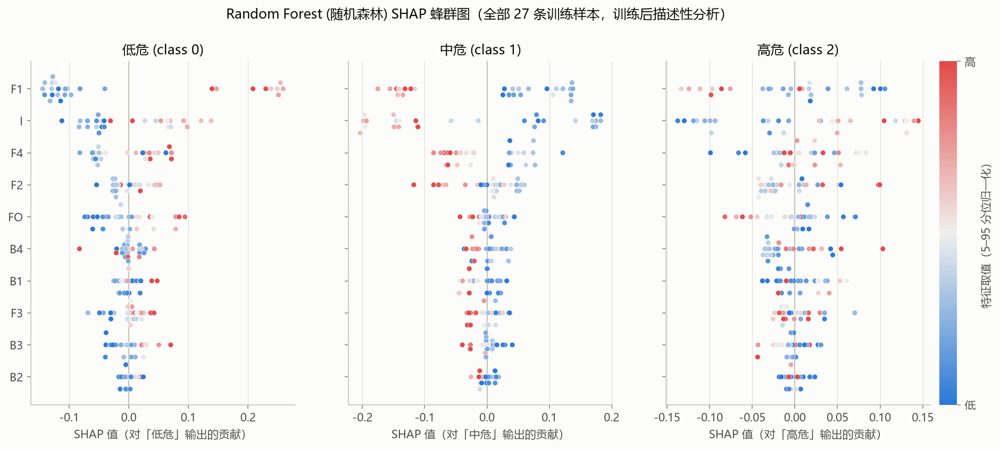

### 7.2 SHAP 依赖图：重要特征的取值—贡献关系

横轴为特征原始取值，纵轴为 SHAP 值，三种颜色分别对应对三个类别输出的贡献。树模型的依赖关系通常呈阶梯状（分裂阈值）；同一取值下点的纵向分散来自与其他特征的交互。细线为线性趋势，只作方向参考。

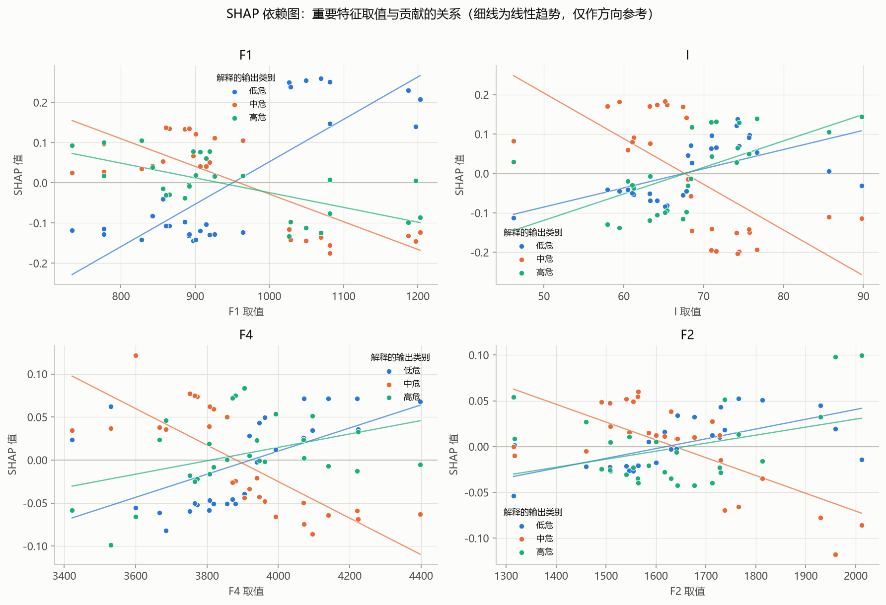

### 7.3 SHAP 瀑布图：单个样本的预测是怎么来的

对每个真实类别，选全量模型给该类打分最高的样本（低危_r3、中危_r10、高危_r10），把「该类输出」分解为基准值 E[f(x)] 加上各特征贡献。条越长，影响越大；红色推高、蓝色拉低该类输出。注意全量模型在训练集上 Accuracy 很高，这些样本都被它「见过」，瀑布图展示的是模型如何记住它们，不是对新样本的预测解释。

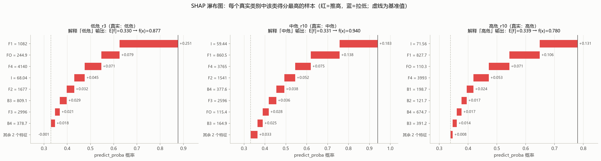

### 7.4 折外 SHAP 与排名稳定性

第 4.9 节与上面各图都用全量模型解释它见过的样本。这里换成**折外**解释：外层每折的调参模型（只用该折训练集拟合）解释该折测试样本，拼成 27 条折外 SHAP。全量排名与折外排名的 Spearman 相关为 **0.98**；在全部 5 个折中都排进前三的特征：无；进前三次数最多的是 I、F1（4/5 折）。全量与折外排名一致性越高，越说明排名不只是「解释见过的样本」造成的；但逐折排名仍会跳动，见下表标准差列。

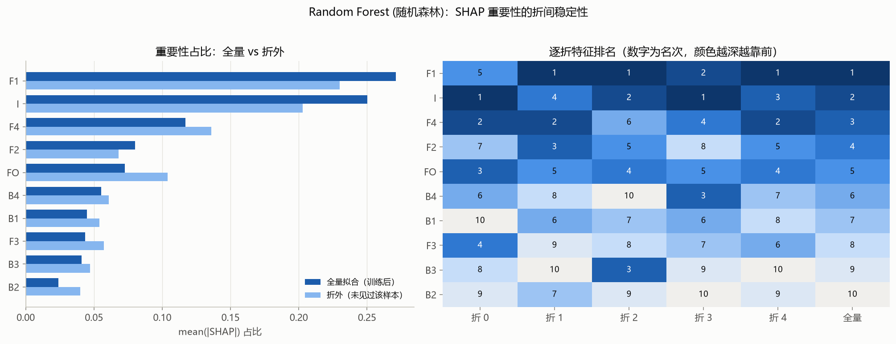

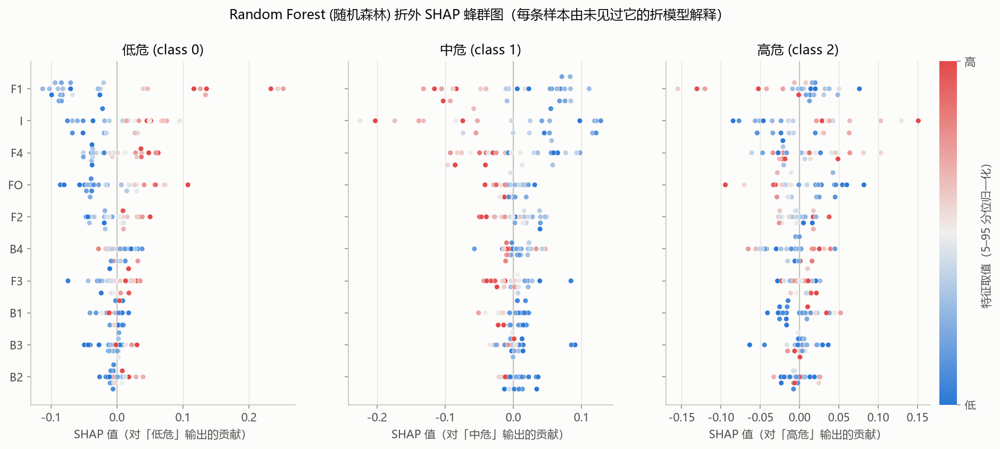

| 特征 | 全量排名 | 折外排名 | 逐折排名均值 | 逐折排名标准差 | 进入前三的折数 |
| --- | --- | --- | --- | --- | --- |
| F1 | 1 | 1 | 2.000 | 1.549 | 4/5 |
| I | 2 | 2 | 2.200 | 1.166 | 4/5 |
| F4 | 3 | 3 | 3.200 | 1.600 | 3/5 |
| F2 | 4 | 5 | 5.600 | 1.744 | 1/5 |
| FO | 5 | 4 | 4.200 | 0.748 | 1/5 |
| B4 | 6 | 6 | 6.800 | 2.315 | 1/5 |
| B1 | 7 | 8 | 7.400 | 1.497 | 0/5 |
| F3 | 8 | 7 | 6.800 | 1.720 | 0/5 |
| B3 | 9 | 9 | 8.000 | 2.608 | 1/5 |
| B2 | 10 | 10 | 8.800 | 0.980 | 0/5 |

逐折排名基于该折训练集上的 mean(|SHAP|)。排名在折间跳动越大，越说明「哪个特征最重要」本身受样本构成影响，不宜把单次全量 SHAP 排名当作稳定结论。

### 7.5 六模型 SHAP 重要性对比

六个模型都在全部样本上按主实验同一搜索空间做训练内调参后拟合，再分别计算 SHAP。由于输出空间不同（概率 / 决策分数 / margin），绝对值不可比，热力图中每个模型的重要性已归一化为占比。在至少 4 个模型中排进前三的特征：**F1、I**——跨模型一致出现的特征，比只在单个模型里重要的特征更值得进一步关注。

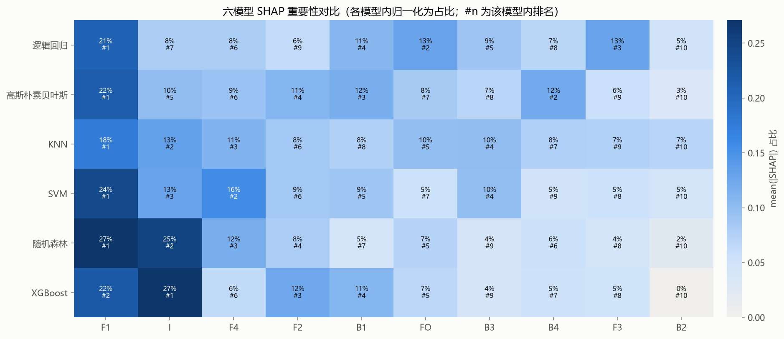

| 模型 | 解释器 | 输出空间 | 前三特征 | 与随机森林排名相关 ρ |
| --- | --- | --- | --- | --- |
| 逻辑回归 | KernelExplainer | predict_proba 概率 | F1、FO、F3 | 0.261 |
| 高斯朴素贝叶斯 | KernelExplainer | predict_proba 概率 | F1、B4、B1 | 0.661 |
| KNN | KernelExplainer | predict_proba 概率 | F1、I、F4 | 0.806 |
| SVM | KernelExplainer | decision_function 决策分数 | F1、F4、I | 0.709 |
| 随机森林 | TreeExplainer | predict_proba 概率 | F1、I、F4 | 1.000 |
| XGBoost | TreeExplainer | 原始 margin | I、F1、F2 | 0.867 |

注意：这些模型的 OOF 表现大多接近基线（见第 4.11、6.3 节），对表现差的模型做解释，解释的是它学到的（可能是噪声的）规律，不能当作特征有效性的证据。

## 8 最终模型

最终演示模型为 **Random Forest (随机森林)**，在全部 27 条样本上重新做训练内 3 折调参后拟合。
- 最终超参数：`{'n_estimators': 300, 'min_samples_leaf': 1, 'max_features': 1.0, 'max_depth': None}`
- 训练内 CV 最优 macro-F1：0.470
- 训练集（全 27 条）Accuracy=1.000，macro-F1=1.000（训练集得分不得替代上面的 OOF 性能）。
- 分数类型：predict_proba 概率。
- 已保存：`models/final_pipeline.joblib`（含预处理+模型），`models/final_metadata.json`（特征顺序与标签映射）。

## 9 结论与限制

在当前 27 条样本、外层 5 折内层 3 折嵌套 CV 方案下，按**预先固定**的 macro-F1 规则，胜者为 **Random Forest (随机森林)**（OOF macro-F1=0.5386、Accuracy=0.5556）。

但必须同时说明三点：

1. **它只在部分指标上胜出。** macro ROC-AUC 与 mAP 最好的调参模型分别是 XGBoost（AUC=0.6584）与 XGBoost（mAP=0.5425），不能说随机森林在所有指标上都最优。
2. **胜者的分数含事后挑选的乐观性。** 它是在同一批折外预测上挑出的最高分；各模型的嵌套评估不能自动成为「获胜模型选择过程」的无偏估计。（报告 §4.11 另给出一个不含事后挑选的内层选择策略结果作为对照，但那是**另一套策略**的表现，两者之差不可解释为偏差大小。）
3. **逐类看，最要紧的问题是高危类几乎识别不出**（召回率见 §4.8）。整体 Accuracy 主要由低危与中危两类支撑。

调参对个别模型有提升（如随机森林、XGBoost），对部分模型反而下降，反映出小样本下内层选择噪声大。受样本量限制，所有模型 OOF 指标波动较大，不能据此声称临床部署有效或外部人群泛化良好。

**扩展分析（第 5–7 章）补充的要点：**

- **高危类几乎没有可用的区分能力**：6 个调参模型中有 6 个的高危类 OvR AUC 低于 0.5（§5.3），与高危召回率低（§4.8）相互印证。
- **标签置换检验**（默认超参数，100 次置换，§6.3）：没有任何模型达到 p<0.05，无法排除「分数只是随机水平」。
- **结论对评估方案敏感**：换用不同 CV 方案或随机切分，同一模型的 macro-F1 与模型名次都会明显变化（§5.7、§6.1、§6.2）；留一法在本数据上对先验基线有系统性悲观偏差。
- **SHAP**：最终模型前三重要特征为 F1、I、F4；在至少 4 个模型中都排进前三的是 F1、I（§7.5），全量与折外 SHAP 排名的 Spearman ρ=0.98（§7.4）。这只说明模型「用了」哪些特征；在整体性能接近基线时，不能当作诊断指标有效的证据。

### 9.1 关键限制

- 仅 27 条样本（每类 9 条），外层每折仅 5–6 条，OOF 指标方差大、置信范围宽；任何结论都是低统计功效下的初步观察。
- 没有患者 ID，无法核实同一人是否存在重复录音跨行；本实验把‘每行独立’作为暂定假设，未声称已排除患者级泄漏。
- 标准差是跨折变动，不是置信区间，也不是临床不确定性范围。
- 获胜模型得分存在选择乐观性（在多个模型中挑最高分本身会高估该模型）。
- SHAP 为全量训练后描述性分析，不是外部验证解释，也不是因果关系证据。
- 样本来源、特征单位与采集协议未提供，结果不可外推到其他人群或设备。
- 胜者的 bootstrap 95% 区间很宽：Accuracy [0.370, 0.741]、macro-F1 [0.362, 0.701]，各模型区间大量重叠，不能按点估计大小排出可信的名次。
- 胜者相对 Dummy 先验基线的精确 McNemar 检验 p=0.0768（>0.05），以本样本量尚不足以证明「有真实优于基线的判别能力」。
- 内层选择策略（每折按内层 macro-F1 选模型）在外层评估中得 Accuracy=0.481、macro-F1=0.462，低于事后挑出的胜者分数。但这是**两套不同策略**的结果，差值同时混合策略差异、有限样本波动与选择效应，**不能解释为选择偏差的大小**，也不是胜者的偏差校正成绩；能说的只是结论对「用哪种方式选模型」敏感。
- bootstrap 区间固定了已经拟合好的折外预测，只对 27 行做样本级重采样；它**没有**重新执行训练、调参、切分与胜者选择，也未建模交叉验证各折训练集之间的重叠。因此不能把它当作「完整建模流程泛化性能」的已证 95% 置信区间。本轮 2000 次重采样中未出现缺类抽样（见 results/uncertainty.csv 的 n_invalid 列），故区间数值未受缺类处理规则影响。
- McNemar 检验的「精确」仅指二项尾概率的算法精确。由于胜者本身来自同一批折外预测的筛选、各折模型又共享训练数据，它不构成对整个选模流程的精确检验；它也比较错误率，不检验 macro-F1、AUC 或排序质量。应按**探索性比较**理解，其 p 值不宜作为强证据。

---

报告由 `main.py` 自动生成；复现命令见 `README.md`。所有原始附件保持不变。
